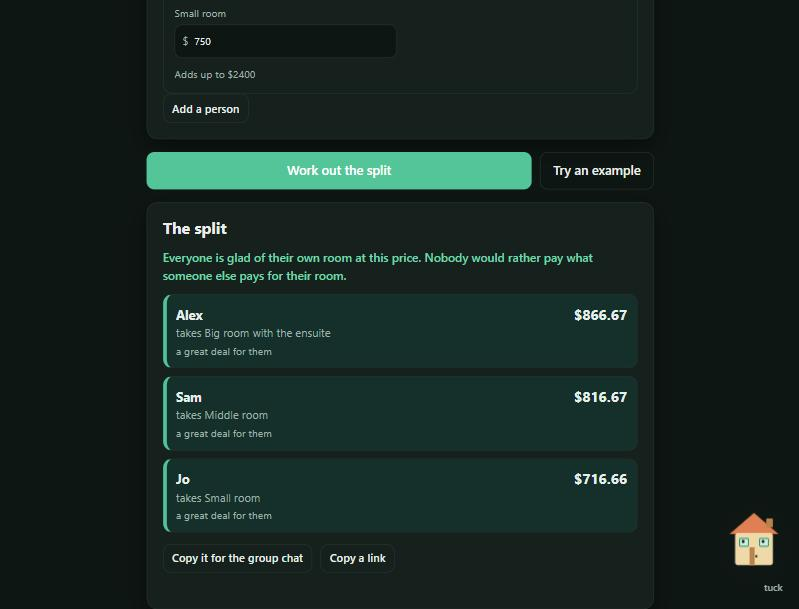

# Divvy

Split the rent between housemates when the rooms aren't the same. Everyone says what each room is worth to them, and Divvy hands out the rooms and sets each room's rent so that nobody would rather have paid for someone else's. Nook the little house helps you set it up.

**Live:** https://divvy.johanthegoat.xyz



## The problem

Three friends take a flat with three different rooms: one has an ensuite, one is a decent double, one is the box room. Splitting the rent in equal thirds isn't fair, and there's no obvious right number for each room. So people either guess, argue, or let the loudest housemate take the best room at an equal share. It's a classic sore point, and it's the exact problem the [New York Times rent calculator](https://www.nytimes.com/interactive/2014/science/rent-division-calculator.html) and [Spliddit](http://www.spliddit.org/apps/rent) were built to solve.

The question that actually settles it isn't "what is each room worth?" in the abstract, it's "what is each room worth **to you**?" Once everyone answers that, there's a split that no one can fairly complain about.

## What a fair split means here

Divvy aims for an **envy-free** split: every person is at least as happy with their own room, at their own rent, as they would be with anyone else's room at that person's rent. If you can look at what everyone else pays and still be glad of your own deal, nobody was hard done by. The rents always add up to the real total.

That such a split always exists is a known result in fair division:

- Francis Su, [*Rental Harmony: Sperner's Lemma in Fair Division*](https://www.math.hmc.edu/~su/papers.dir/rent.pdf), American Mathematical Monthly, 1999.
- Alkan, Demange and Gale, *Fair Allocation of Indivisible Goods and Criteria of Justice*, Econometrica, 1991.
- Gal, Mash, Procaccia and Zick, [*Which Is the Fairest (Rent Division) of Them All?*](https://procaccia.info/papers/rent.pdf), which is the method behind Spliddit.

## How it works

1. **Your place.** Put in the total rent and name each room.
2. **The bids.** For each person, spread the rent across the rooms the way they'd happily pay. More on the room they want. The amounts are a wish, not a promise, so they don't have to add up exactly.
3. **The split.** Divvy gives each person a room and a rent, and tells you plainly that everyone is glad of their own room at that price.

### The engine

`src/engine.js` has no page code, so the site and `node --test` run the same logic.

- **Whole cents.** Amounts are read into integers (`"2,400"`, `"£900"`, `"1.234,50"` all work), so nothing drifts from floating-point maths.
- **Same scale.** Each person's bids are scaled to add up to the rent, which puts everyone on the same footing while keeping their likes and dislikes. Someone who leaves their bids blank is treated as liking every room the same.
- **Who gets which room.** The rooms are handed out with the **Hungarian algorithm** (Kuhn, 1955) for the assignment that makes the group happiest overall, so rooms go where they're wanted most.
- **The rents.** The Hungarian algorithm also returns the dual "potentials" that satisfy `a[i] + b[j] >= value[i][j]`, with equality on matched pairs. The envy-free rents come straight out of those: each room's rent is its potential plus one shift shared equally across all rooms, which meets the real total without changing who envies whom. The reasoning is in the engine's comments.
- **It checks itself.** Before handing back an answer, Divvy verifies no one prefers another room at its rent (to the nearest cent).

The test suite proves the hard part: on **500 random setups** of 2 to 6 people, every answer is envy-free (checked independently by brute force) and the rents always total the rent.

Share links carry the whole setup in the URL fragment (`#...`), which the browser never sends to a server.

### Nook

Nook is an inline SVG house in the corner. Nook's windows are eyes that follow your pointer (or the box you're typing in on a phone), blinks now and then, gives a tip for the step you're on when tapped, opens the door and puffs the chimney when a fair split comes out, looks worried when the people and rooms don't match up, and drops a few keys if you tap five times fast. Nook can be tucked away, holds still if your device asks for reduced motion, and everything Nook says is read out by screen readers through a live region.

## Run it

Open `index.html` in a browser. No build step, no dependencies.

```bash
npm test
```

Runs on Node 20, 22 and 24 in CI.

## License

MIT.
